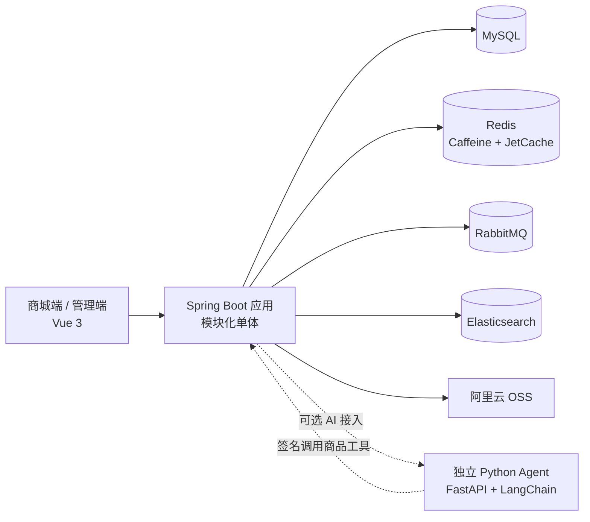

# MallX

面向学习与实践的高并发电商项目，覆盖商城前台、运营后台和模块化 Java 后端。项目围绕真实交易链路实现缓存、库存、订单、消息队列与商品搜索，并提供可复现的压测报告和模块设计文档。

> 当前项目以本地开发与功能验证为主。性能数据来自单机测试环境，用于同环境对比，不代表生产环境容量。

## 项目亮点

- **模块化单体后端：** 使用 Spring Boot 按认证、用户、商品、库存、购物车、订单、支付、优惠券、秒杀、搜索、售后和管理后台划分模块，模块间通过服务调用协作。
- **多级缓存：** 使用 JetCache 组合 Caffeine 与 Redis，为热点商品和首页数据提供本地及分布式缓存；配合布隆过滤器、空值缓存和缓存击穿保护。
- **异步秒杀：** 使用 Redis Lua 原子预扣库存和限制用户重复参与，通过 RabbitMQ 异步创建订单，并结合幂等校验与补偿任务处理最终一致性。
- **商品搜索：** 使用 Elasticsearch 与 IK 分词实现全文搜索、条件筛选、排序、高亮和联想；通过 Outbox 与 RabbitMQ 异步同步商品索引。
- **可靠消息与订单超时：** 使用 RabbitMQ Confirm、Return、TTL、死信队列、幂等消费与补偿任务，处理投递失败、重复消费和未支付订单关闭。
- **认证与后台权限：** 使用 Sa-Token、RBAC 和 Access/Refresh 双 Token，支持登录态续期、令牌轮换与会话注销。
- **前后端分离：** Vue 3 分别构建商城端与管理端；管理员操作集中在后台，并记录关键操作日志。

## 技术栈

| 部分 | 技术 |
| --- | --- |
| 后端 | Java 17、Spring Boot 3、Spring MVC、MyBatis-Plus、Maven |
| 数据与缓存 | MySQL、Redis、Caffeine、JetCache、Redisson |
| 消息与搜索 | RabbitMQ、Elasticsearch、IK 分词 |
| 前端 | Vue 3、Vue Router、Pinia、Element Plus、Axios、Vite、npm Workspaces |
| 文件存储 | 阿里云 OSS |
| AI 接入 | `mall-ai` Java 模块；独立 Python Agent 服务使用 FastAPI、LangChain 与 DeepSeek，单独维护 |

## 架构概览

## 模块结构

| 路径 | 职责 |
| --- | --- |
| `mallx-application` | Spring Boot 启动模块及应用配置 |
| `mall-common` | 通用响应、异常处理、缓存、Redis、RabbitMQ 等基础能力 |
| `mall-auth`、`mall-user` | 登录认证、双 Token、用户与地址 |
| `mall-product`、`mall-inventory` | 商品、分类、品牌、SKU 与库存 |
| `mall-cart`、`mall-order`、`mall-payment` | 购物车、订单与支付流程 |
| `mall-coupon`、`mall-seckill` | 优惠券与秒杀活动 |
| `mall-search` | Elasticsearch 商品索引与搜索 API |
| `mall-after-sale`、`mall-admin` | 售后及后台管理、RBAC、操作审计 |
| `mall-ai` | Java 侧 AI API、会话与内部工具安全接入 |
| `_UI/storefront`、`_UI/admin` | 商城前台和管理后台 |
| `docs` | 模块设计、验收记录与压测报告 |

## 本地运行

### 环境依赖

- JDK 17 或更高版本
- Maven（或使用项目根目录的 `mvnw`，如果已提供）
- Node.js 22.12 或更高版本及 npm
