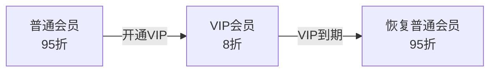
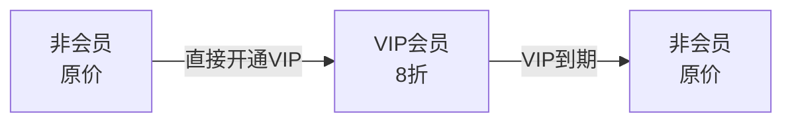
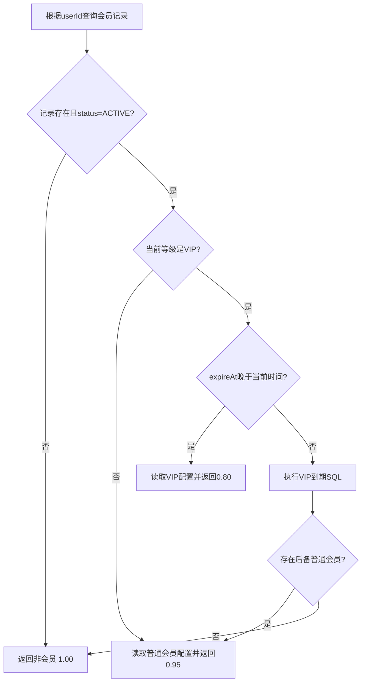

# MallX 用户会员模块设计与处理逻辑

## 1. 文档目的

本文说明 `mall-user` 中会员模块的业务规则、数据结构和代码执行流程，重点回答以下问题：

- 用户到底有哪几种会员状态？
- 普通会员升级 VIP 后，VIP 到期为什么能恢复普通会员？
- 非会员直接开通 VIP，到期后为什么是非会员？
- `cancelMembership()` 具体取消什么？
- 为什么 VIP 到期处理需要一条较复杂的 SQL？
- 定时任务和查询时检查为什么同时存在？

本模块不包含会员成长值、积分升级、会员任务或自动升级体系。

---

## 2. 核心业务规则

MallX 只有两个真实会员等级：

| 等级值 | 等级 | 折扣 | 有效期 |
|---:|---|---:|---|
| 1 | 普通会员 | 95 折 | 默认永久 |
| 2 | VIP 会员 | 8 折 | 必须设置到期时间 |

非会员使用值 `0` 对外展示，但它不是数据库中的会员等级，也不会写入 `member_level`。

### 2.1 新用户

新用户默认没有会员：

```text
user_membership 中没有记录
        ↓
对外返回非会员
        ↓
discountRate = 1.00
```

系统不会因为用户注册或首次查询，就自动给用户创建普通会员。

### 2.2 普通会员升级 VIP

普通会员开通 VIP 时，VIP 是对普通会员权益的临时覆盖，而不是永久删除普通会员身份：



升级时会保存：

```text
fallback_level_code = 1
fallback_start_at = 原普通会员生效时间
```

VIP 到期后，系统使用这两个字段恢复普通会员。

### 2.3 非会员直接开通 VIP

非会员没有可以恢复的基础会员身份：



此时：

```text
fallback_level_code = null
fallback_start_at = null
```

所以 VIP 到期后，记录会被标记为已过期，用户重新成为非会员。

### 2.4 VIP 续期

VIP 续期只更新 `expire_at`，不会覆盖后备会员信息。

因此普通会员升级而来的 VIP 即使续期多次，最终到期后仍然恢复原普通会员。

### 2.5 主动取消会员

`cancelMembership()` 的语义是取消用户的全部会员权益，而不是只取消 VIP 覆盖层。

| 取消前 | 取消后 |
|---|---|
| 普通会员 | 非会员 |
| VIP（从非会员开通） | 非会员 |
| VIP（从普通会员升级） | 非会员，不恢复普通会员 |

取消时会：

```text
status = 3
fallback_level_code = null
fallback_start_at = null
```

如果以后需要“提前结束 VIP，但保留并恢复普通会员”，应新增语义独立的方法，例如 `cancelVip()`，不应改变 `cancelMembership()` 的含义。

---

## 3. 三张数据库表的职责

### 3.1 `member_level`：会员等级配置

该表保存会员等级名称和折扣配置。

初始化数据：

```text
1 = 普通会员，discount_rate = 0.9500
2 = VIP会员，discount_rate = 0.8000
```

Java 代码不写死最终折扣金额，查询有效会员时从该表取得折扣率。

主要字段：

| 字段 | 说明 |
|---|---|
| `level_code` | 1 普通会员、2 VIP |
| `level_name` | 展示名称 |
| `discount_rate` | 折扣率 |
| `priority` | 等级优先级 |
| `enabled` | 是否允许新开通 |

### 3.2 `user_membership`：用户当前会员状态

一个用户最多一条记录，主键是 `user_id`。

主要字段：

| 字段 | 说明 |
|---|---|
| `user_id` | 用户 ID |
| `level_code` | 当前会员等级：1 或 2 |
| `start_at` | 当前等级生效时间 |
| `expire_at` | VIP 到期时间，普通会员为空 |
| `status` | 1 生效、2 过期、3 取消 |
| `fallback_level_code` | VIP 到期后需要恢复的等级，目前只会是 1 |
| `fallback_start_at` | 原普通会员生效时间 |

### 3.3 `user_membership_log`：会员变更日志

该表记录每次会员状态变化，方便后台审计和问题排查。

变更类型：

| 值 | 枚举 | 含义 |
|---:|---|---|
| 1 | `OPEN` | 开通会员 |
| 2 | `UPGRADE` | 普通会员升级 VIP |
| 3 | `CHANGE` | 主动调整等级 |
| 4 | `RENEW` | VIP 续期 |
| 5 | `CANCEL` | 取消全部会员权益 |
| 6 | `EXPIRE` | VIP 到期 |

日志同时保存变更前后等级和到期时间快照。

---

## 4. 典型数据变化示例

### 4.1 普通会员升级 VIP

升级前：

```text
level_code = 1
start_at = 2026-01-01 00:00:00
expire_at = null
status = 1
fallback_level_code = null
fallback_start_at = null
```

开通 VIP 后：

```text
level_code = 2
start_at = VIP开通时间
expire_at = VIP到期时间
status = 1
fallback_level_code = 1
fallback_start_at = 2026-01-01 00:00:00
```

VIP 到期恢复后：

```text
level_code = 1
start_at = 2026-01-01 00:00:00
expire_at = null
status = 1
fallback_level_code = null
fallback_start_at = null
```

### 4.2 非会员直接开通 VIP

开通后：

```text
level_code = 2
start_at = VIP开通时间
expire_at = VIP到期时间
status = 1
fallback_level_code = null
fallback_start_at = null
```

到期后：

```text
level_code = 2       # 保留原等级用于追溯
expire_at = 原到期时间
status = 2           # EXPIRED
fallback_level_code = null
fallback_start_at = null
```

虽然数据库仍保留原 VIP 信息，但对外查询返回的是非会员和原价。

---

## 5. Service 方法说明

核心接口是 `UserMembershipService`。

### 5.1 `getCurrentMembership(userId)`

作用：查询用户此刻真正生效的会员权益。

执行流程：



查询接口自身会检查到期时间，所以不依赖定时任务准时执行。

### 5.2 `activateNormal(userId, operatorId, remark)`

作用：开通永久普通会员，或者显式把现有会员调整为普通会员。

主要处理：

- 已经是有效普通会员时直接返回，保证幂等。
- 非会员开通时创建或重新激活会员记录。
- VIP 被显式调整为普通会员时，清空 VIP 到期时间和后备字段。
- 写入会员变更日志。

### 5.3 `activateVip(userId, expireAt, operatorId, remark)`

作用：开通 VIP、普通会员升级 VIP 或 VIP 续期。

处理分支：

| 当前状态 | 操作类型 | 后备身份 |
|---|---|---|
| 非会员 | `OPEN` | 无 |
| 普通会员 | `UPGRADE` | 保存普通会员 |
| VIP | `RENEW` | 保留原后备身份 |

VIP 到期时间必须晚于当前时间。

### 5.4 `cancelMembership(userId, operatorId, remark)`

作用：取消全部会员权益。

特点：

- 没有有效会员时直接返回，保证幂等。
- 普通会员和 VIP 都可以被取消。
- 取消 VIP 时不会恢复后备普通会员。
- 不删除数据，而是设置 `status = CANCELED`。
- 不影响账号、订单、优惠券和用户资料。

### 5.5 `expireVipMemberships(batchSize)`

作用：供定时任务批量收敛数据库中的过期 VIP 状态。

普通条件查询使用 MyBatis-Plus Lambda：

```text
level_code = VIP
status = ACTIVE
expire_at <= 当前时间
按 expire_at 升序
限制批次大小
```

每次默认最多处理 500 条，Service 允许的批次范围是 1 到 1000。

---

## 6. VIP 到期 SQL 为什么较复杂

VIP 到期存在两个不同结果：

```text
有 fallback_level_code = 1  → 恢复普通会员
没有 fallback_level_code    → VIP标记为已过期
```

因此同一条更新 SQL 需要根据后备字段同时决定：

- 最终 `level_code`
- 最终 `start_at`
- 是否清空 `expire_at`
- 最终 `status`
- 是否清空后备字段

这些字段必须在一次数据库更新中完成，不能先查再执行多次普通更新，否则查询接口和定时任务并发时可能重复处理或产生中间状态。

该 SQL 放在：

```text
mall-user/src/main/resources/mapper/UserMembershipMapper.xml
```

XML 只保存这条包含多个 `CASE` 分支的复杂 SQL。单行行锁查询继续使用 `@Select`，普通条件查询使用 MyBatis-Plus Lambda。

SQL 的 `WHERE` 条件包含：

```text
user_id匹配
level_code = VIP
status = ACTIVE
expire_at不为空
expire_at <= 当前时间
```

并发情况下只有第一次更新能匹配这些条件。更新完成后等级或状态发生变化，后续执行更新行数为 0，因此不会重复写入到期日志。

---

## 7. 为什么既有实时检查又有定时任务

### 实时检查负责正确性

用户查询会员权益或以后订单计算折扣时，会立即检查 `expire_at`。

即使定时任务延迟，过期 VIP 也不能继续享受 8 折。

### 定时任务负责状态收敛

`MembershipExpireTask` 默认每 5 分钟运行一次，把无人访问的过期 VIP 状态同步到数据库。

```text
配置项：mallx.user.membership-expire-cron
默认值：0 */5 * * * *
默认批次：500
```

两者的职责不是重复的：

```text
查询时检查 = 保证业务结果立即正确
定时任务   = 保证数据库状态最终整洁
```

---

## 8. 并发控制

### 8.1 开通、升级、续期和取消

会员变更前会先锁定用户资料行，再查询并锁定会员记录：

```text
锁定 user_profile
        ↓
SELECT user_membership ... FOR UPDATE
        ↓
修改会员记录
        ↓
写入会员日志
```

先锁用户资料的原因是：新用户可能尚无 `user_membership` 记录，此时无法锁住一条不存在的会员行。用户资料行可以作为每个用户都稳定存在的互斥点。

### 8.2 到期处理

查询请求和定时任务可能同时发现同一个 VIP 已过期。

到期更新使用带状态条件的单条 SQL。只有一个执行方能够更新成功并写入日志，另一个执行方得到更新行数 0。

---

## 9. 对外接口

当前只开放本人会员权益查询：

```http
GET /users/me/membership
```

用户 ID 通过公共 `CurrentUserProvider` 获取，不由客户端传入。

普通会员响应示例：

```json
{
  "userId": 1001,
  "member": true,
  "levelCode": 1,
  "levelName": "普通会员",
  "discountRate": 0.9500,
  "startAt": "2026-01-01T00:00:00",
  "expireAt": null,
  "status": 1
}
```

非会员响应示例：

```json
{
  "userId": 1001,
  "member": false,
  "levelCode": 0,
  "levelName": "非会员",
  "discountRate": 1.00,
  "startAt": null,
  "expireAt": null,
  "status": 0
}
```

开通、续期和取消暂时只提供 Service 能力，没有开放普通用户可直接调用的修改接口。后续应由支付模块或带权限校验的 `mall-admin` 调用。

---

## 10. 与订单模块的边界

会员模块只提供当前有效等级和折扣率，不直接修改订单金额。

以后订单模块应在创建订单时保存会员优惠快照：

```text
下单时会员等级
下单时会员折扣率
会员优惠金额
```

这样用户后续升级、到期或取消会员，都不会改变历史订单金额。

推荐计算顺序：

```text
商品原始金额
    ↓
会员折扣
    ↓
优惠券或满减
    ↓
最终应付金额
```

具体叠加规则最终由订单和营销模块决定。

---

## 11. 代码位置

| 内容 | 路径 |
|---|---|
| 当前用户查询接口 | `mall-user/src/main/java/com/mallx/user/controller/UserMembershipController.java` |
| 会员Service接口 | `mall-user/src/main/java/com/mallx/user/service/UserMembershipService.java` |
| 核心业务实现 | `mall-user/src/main/java/com/mallx/user/service/impl/UserMembershipServiceImpl.java` |
| 自定义Mapper接口 | `mall-user/src/main/java/com/mallx/user/mapper/UserMembershipMapper.java` |
| 复杂到期SQL | `mall-user/src/main/resources/mapper/UserMembershipMapper.xml` |
| 会员实体 | `mall-user/src/main/java/com/mallx/user/entity/UserMembership.java` |
| 等级枚举 | `mall-user/src/main/java/com/mallx/user/enums/MemberLevelCode.java` |
| 状态枚举 | `mall-user/src/main/java/com/mallx/user/enums/MembershipStatus.java` |
| 变更类型枚举 | `mall-user/src/main/java/com/mallx/user/enums/MembershipChangeType.java` |
| 到期定时任务 | `mall-user/src/main/java/com/mallx/user/task/MembershipExpireTask.java` |
| 完整建表脚本 | `mall-user/src/main/resources/db/schema-membership.sql` |
| 旧表升级脚本 | `mall-user/src/main/resources/db/migration-membership-vip-fallback.sql` |

---

## 12. 一句话理解整个模块

会员模块使用一条 `user_membership` 记录表示用户当前有效权益；普通会员升级 VIP 时，把普通会员保存为后备身份，VIP 到期后原子恢复普通会员，而没有后备身份的 VIP 到期后变为非会员。
